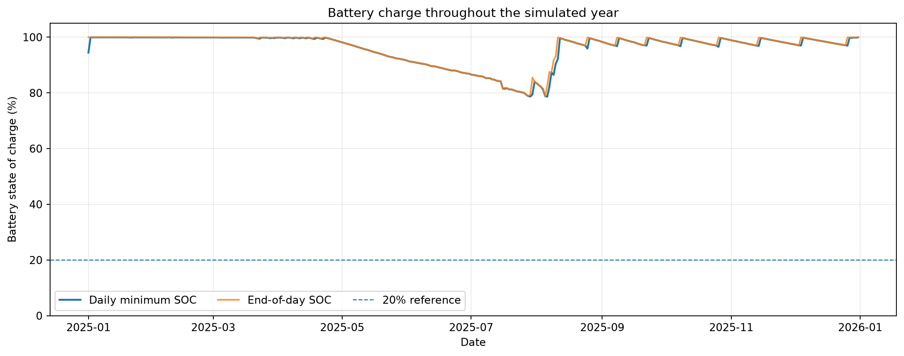
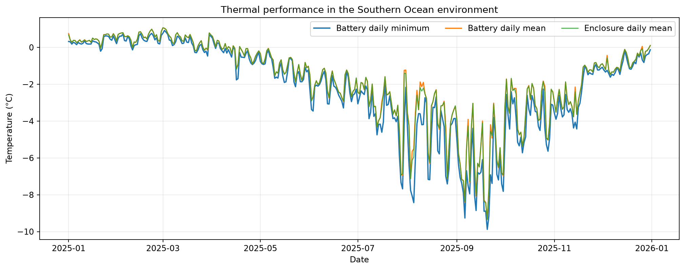
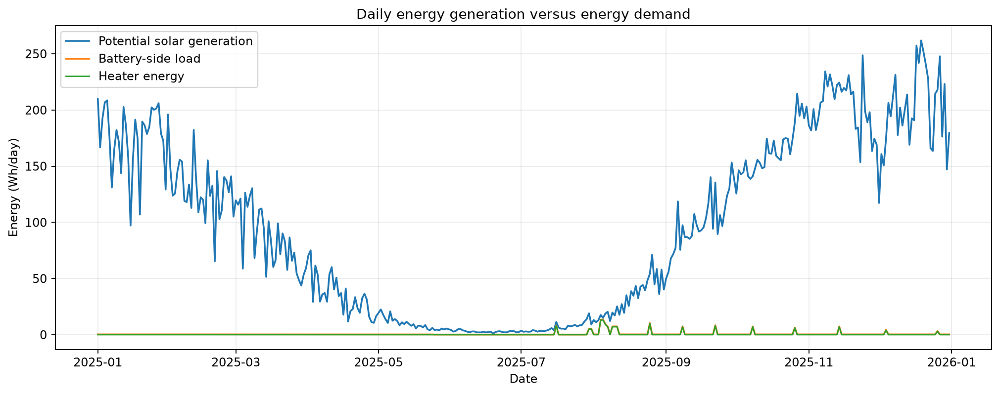
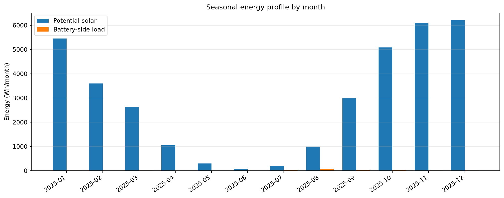
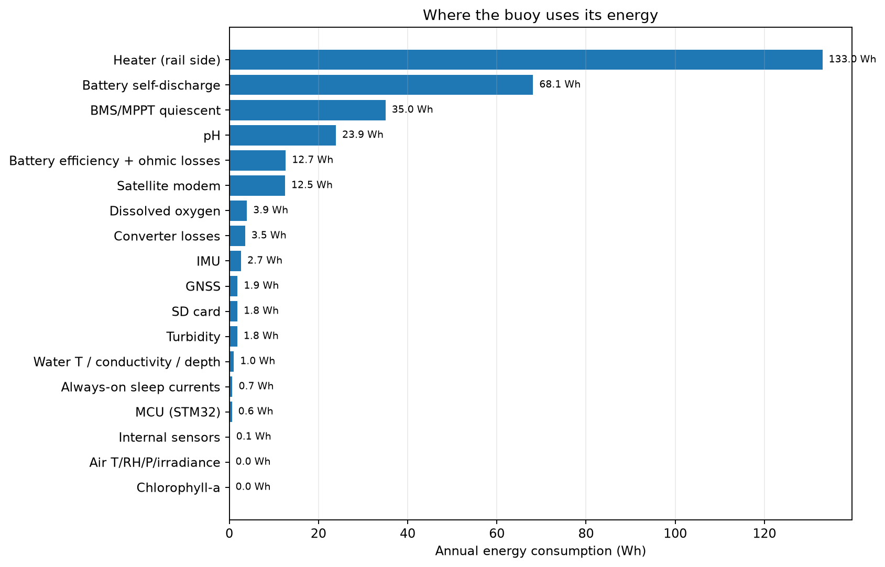
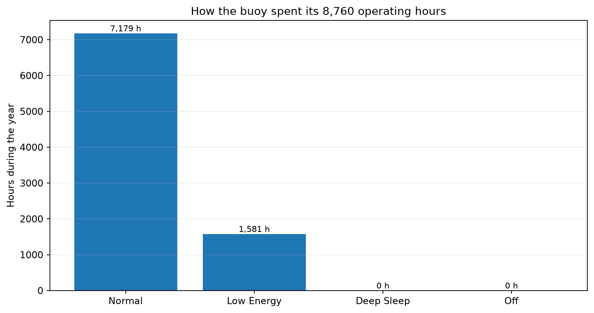
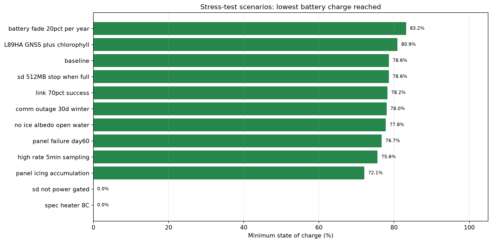
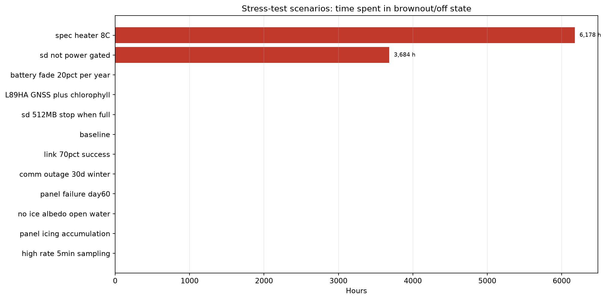
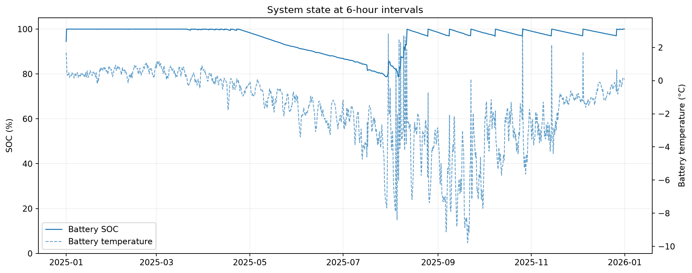

# BOYANT — Iteration 2

**A simulation framework for evaluating the energy, thermal behaviour and operational reliability of a solar-powered ocean buoy.**

Iteration 2 models a buoy operating for one year at a Southern Ocean reference location. It combines hourly NASA POWER weather data with a 10-minute simulation time step to estimate solar harvesting, battery behaviour, thermal conditions, power consumption, operating modes, data logging and communications.

> **Scope:** This repository iteration is a simulation study. The results below are model outputs, not measurements from a deployed buoy or proof of real-world performance.

---

## At a glance

| Parameter | Configuration |
|---|---:|
| Simulation period | 365 days (2025) |
| Reference location | 63.6686° S, 40.4935° E |
| Weather source | NASA POWER hourly data |
| Weather time basis | Local Solar Time (LST) |
| Simulation time step | 10 minutes |
| Solar panels | 8 × 7.055 W STC (modelled) |
| Battery | 4S LiFePO₄, 192 Wh nominal |
| Heater | 6 W |
| Baseline result | Full simulated year completed; no brownout |

## What the model represents

- **Solar harvesting:** panel orientation, irradiance on the panel plane, temperature and conversion losses, wiring/MPPT efficiency, panel mismatch, icing and panel-failure scenarios.
- **Battery and power:** state of charge, temperature-dependent usable capacity and internal resistance, charge/discharge limits, self-discharge, ageing and electrical losses.
- **Thermal behaviour:** separate enclosure and battery thermal nodes, thermal coupling, environmental heat transfer and heater control.
- **Power management:** normal and low-energy operating modes, scheduled sensor/IMU/GNSS/communications tasks, and brownout behaviour.
- **Data and communications:** SD-card capacity policies, telemetry attempts, communication outages, packet backlog and packet-loss accounting.
- **Validation and traceability:** weather-data quality checks, configuration validation, energy-balance checks, run metadata and scenario comparisons.

Some environmental and physical quantities remain assumptions rather than measured inputs. See [Model assumptions and limitations](#model-assumptions-and-limitations).

---

## Baseline simulation results

The baseline run completed all 8,760 hourly records. The weather loader reported zero interpolated hours.

| Metric | Result |
|---|---:|
| Minimum battery SOC | **78.6%** |
| Date of minimum SOC | 2025-08-06 |
| Ending battery SOC | **100.0%** |
| Brownout/off duration | **0.0 h** |
| Minimum battery temperature | **-9.9 °C** |
| Heater energy | 133.0 Wh |
| Potential PV generation | 34.674 kWh |
| Energy accepted into battery | 155.3 Wh |
| Curtailed PV energy | 34364.6 Wh |
| Battery-side load | 222.6 Wh |
| Packets dropped | 0 |
| Energy-balance residual | 6.34e-12 Wh |

### 1. Battery state of charge

Shows the daily minimum and end-of-day battery state of charge. The minimum SOC is a useful indicator of the tightest energy point in the simulated year.



### 2. Thermal performance

Tracks battery and enclosure temperatures. This helps assess the cold-environment assumptions and when thermal protection may become relevant.



### 3. Daily energy generation and demand

Compares potential solar generation with battery-side load and heater energy. Potential PV energy is not the same as energy stored: charge acceptance, conversion losses and curtailment affect what reaches the battery.



### 4. Seasonal energy profile

Compares monthly solar potential and battery-side energy demand to make seasonal changes easier to understand.



### 5. Energy use by subsystem

Breaks down the modelled annual energy consumption across the buoy's electronics and subsystems. These estimates should be checked against selected component datasheets and actual duty cycles.



### 6. Operating modes

Shows how many hours the buoy spends in normal, low-energy, deep-sleep and off/brownout modes.



---

## Stress-test scenarios

The scenario runner changes selected configuration or operating conditions to explore how the simulated buoy responds. The table below is taken from `scenario_comparison.csv`.

| Scenario | Minimum SOC | Ending SOC | Brownout/off hours | Survived full period |
|---|---:|---:|---:|---|
| Baseline | 78.6% | 100.0% | 0.0 | Yes |
| Heater setpoint at 8°C | 0.0% | 93.9% | 6177.7 | **No** |
| SD card not power-gated | 0.0% | 99.9% | 3683.7 | **No** |
| Accumulating panel icing | 72.1% | 100.0% | 0.0 | Yes |
| 5-minute sampling | 75.6% | 99.9% | 0.0 | Yes |
| Open-water albedo | 77.8% | 100.0% | 0.0 | Yes |
| L89HA GNSS + chlorophyll | 80.9% | 100.0% | 0.0 | Yes |
| 30-day winter comms outage | 78.0% | 100.0% | 0.0 | Yes |
| 70% link success | 78.2% | 100.0% | 0.0 | Yes |
| 20% annual battery fade | 83.2% | 100.0% | 0.0 | Yes |
| Panel failure on day 60 | 76.7% | 100.0% | 0.0 | Yes |
| 512 MB SD; stop when full | 78.6% | 100.0% | 0.0 | Yes |

## Monte Carlo analysis

A separate run of 200 randomized simulations (4 workers) reported:

| Metric | Result |
|---|---:|
| Monte Carlo runs | 200 |
| Simulated survival fraction | 100% (200/200) |
| Estimated brownout fraction | 0% |
| 95% Wilson confidence interval for survival | 98.12–100% |

These results are conditional on the parameter ranges and probability distributions configured in the Monte Carlo routine. They should not be presented as a real-world reliability guarantee. The current ranges are illustrative and need justification from component specifications, measured performance and environmental uncertainty.

### 7. Minimum SOC under stress tests

Compares the lowest battery SOC reached in each scenario. Lower values indicate less remaining energy margin.



### 8. Brownout/off time under stress tests

Highlights scenarios that cause the model to enter a brownout/off state and shows the duration.



### 9. Hourly system state

A downsampled view of battery SOC and battery temperature across the year.



---

## Running Iteration 2

### Requirements

- Python 3.9 or newer
- NumPy
- Pandas
- Matplotlib (only needed for the visualizer)

Install dependencies in a virtual environment:

```bash
python3 -m venv .venv
source .venv/bin/activate
pip install numpy pandas matplotlib
```

### Run the baseline

```bash
python3 iter2boyant.py \
  --weather ../data/data_nasa.csv \
  --out logs
```

Adjust the weather path to the location of your NASA POWER CSV.

### Run stress-test scenarios

```bash
python3 iter2boyant.py \
  --weather ../data/data_nasa.csv \
  --out logs_scenarios \
  --scenarios
```

### Run Monte Carlo analysis

```bash
python3 iter2boyant.py \
  --weather ../data/data_nasa.csv \
  --out logs_monte_carlo \
  --monte-carlo 200 \
  --workers 4
```

### Run the built-in tests

```bash
python3 iter2boyant.py --selftest
```

### Generate the visual report

The `visualize_boyant.py` script reads the generated CSV/JSON outputs and creates the plots plus a browser dashboard.

```bash
python3 visualize_boyant.py --logs logs_scenarios --out report
```

Open `report/index.html` in a browser. The individual PNGs can also be embedded in presentations or other documentation.

---

## Output files

| Output | Description |
|---|---|
| `hourly_log.csv` | Hourly system, battery, thermal and subsystem state |
| `daily_summary.csv` | Daily energy, SOC, temperatures, modes and event totals |
| `monthly_summary.csv` | Monthly environmental and system summaries |
| `pv_panels_hourly.csv` | Per-panel hourly solar output |
| `subsystem_energy_annual.csv` | Annual energy use by subsystem |
| `event_log.csv` | Recorded simulation events |
| `task_log.csv` | Scheduled task activity |
| `scenario_comparison.csv` | Summary comparison across stress-test scenarios |
| `config_used.json` | Configuration used for the run |
| `kpis.json` | Key performance indicators |
| `run_metadata.json` | Runtime versions, input provenance and weather QC |
| `step_log_10min.csv.gz` | Detailed 10-minute simulation trace |

Scenario-specific daily, hourly-core, event and configuration files are written under `scenarios/`.

---

## Model assumptions and limitations

1. **Weather resolution:** NASA POWER input is hourly. The model maps this onto a 10-minute internal grid; this does not provide true 10-minute cloud observations or resolve fast cloud transients.
2. **Sea surface temperature:** this run uses the configured sinusoidal SST model (`sst_source: sinusoidal model [ASSUMED]`), not a measured SST time series.
3. **Albedo:** monthly albedo values are configured assumptions, not a location-specific time series measured during deployment.
4. **PV and panel behaviour:** panel output depends on configured panel parameters, orientation, conversion factors and simplified icing/failure models. It is not a measured panel power curve.
5. **Battery:** capacity, resistance, self-discharge, charge limits and ageing depend on configured battery assumptions. They should be replaced or calibrated using the selected battery's datasheet and cold-chamber tests.
6. **Thermal model:** the two-node enclosure/battery model is a simplified representation. Heat-transfer coefficients, thermal masses and heater heat split need physical validation.
7. **Loads and duty cycles:** sensor, MCU, GNSS, communications and storage consumption are modelled from configuration. Validate them with component datasheets and measured current profiles.
8. **Reliability statistics:** scenario and Monte Carlo results are conditional on the chosen scenarios, parameter ranges and distributions. They are not field reliability probabilities.

The very large difference between potential PV generation and energy accepted by the battery in the baseline is visible in the energy plots. It should be investigated as part of PV sizing, load sizing and charge-controller validation—not interpreted as proof that the current panel configuration is optimal.

## Next validation steps

- Validate panel output and MPPT behaviour against measured hardware data.
- Replace assumed SST/albedo inputs with appropriate environmental datasets where available.
- Calibrate enclosure and battery thermal behaviour using temperature logging on a physical prototype.
- Measure subsystem current draw and real task duty cycles.
- Test battery charge/discharge restrictions at low temperatures.
- Expand fault tests and justify Monte Carlo ranges using component tolerances and environmental uncertainty.
- Compare simulation predictions with controlled bench tests and, eventually, field data.

---

## Repository structure

```text
Iteration2/
├── iter2boyant.py
├── visualize_boyant.py
├── README.md
├── data/
│   └── data_nasa.csv
├── logs/                    # generated baseline outputs
├── logs_scenarios/          # generated scenario outputs
└── assets/                  # README figures generated from a run
    ├── 01_battery_soc.png
    ├── 02_temperature.png
    ├── 03_daily_energy.png
    ├── 04_monthly_energy.png
    ├── 05_subsystem_energy.png
    ├── 06_operating_modes.png
    ├── 07_scenario_min_soc.png
    ├── 08_scenario_brownout.png
    └── 09_hourly_state.png
```

*BOYANT Iteration 2 — simulation outputs and figures are reproducible from the model code, input weather file and saved configuration.*
