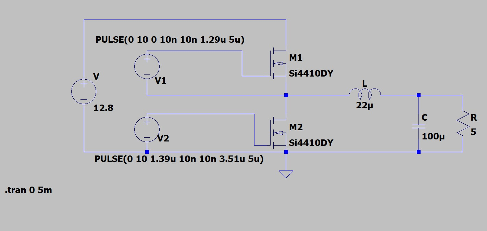
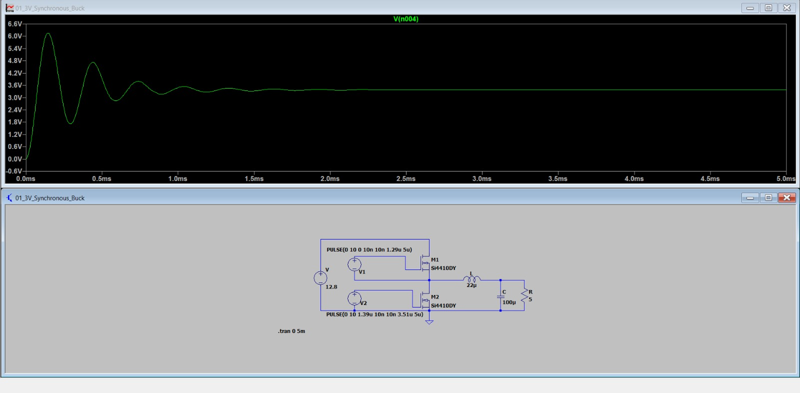
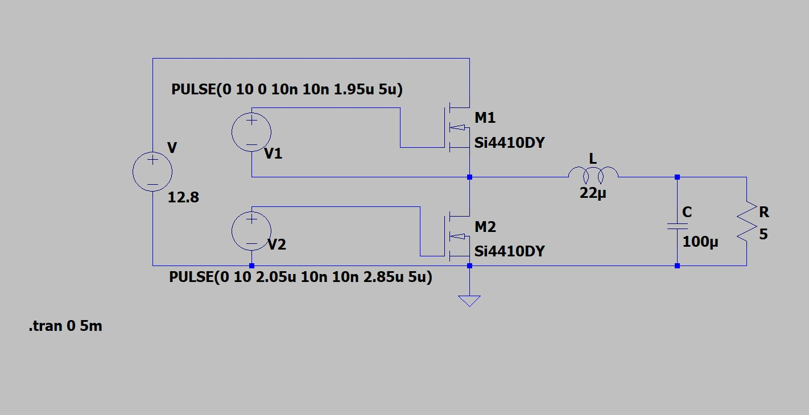
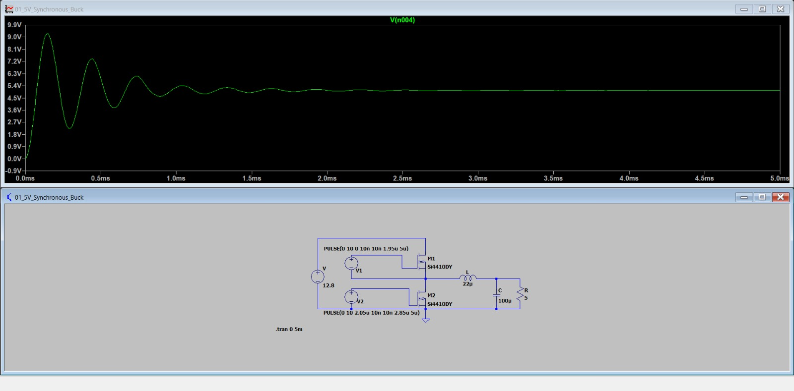
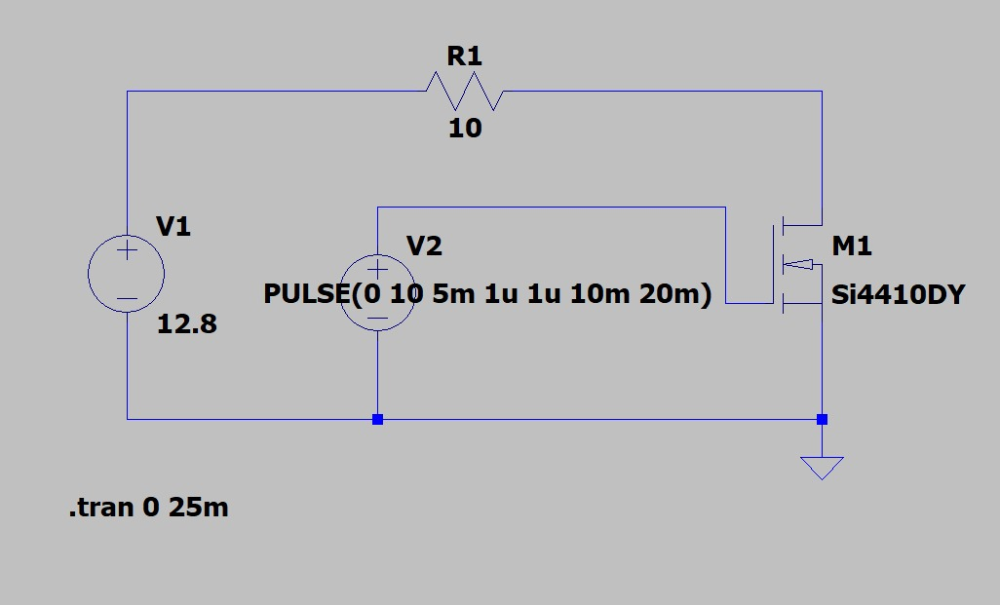
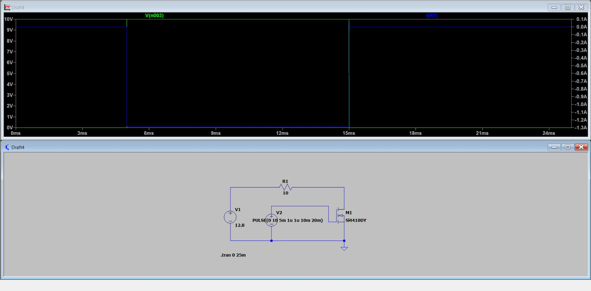
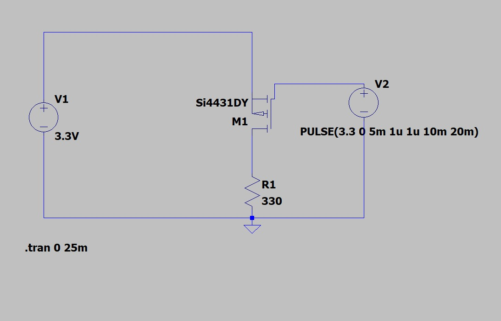
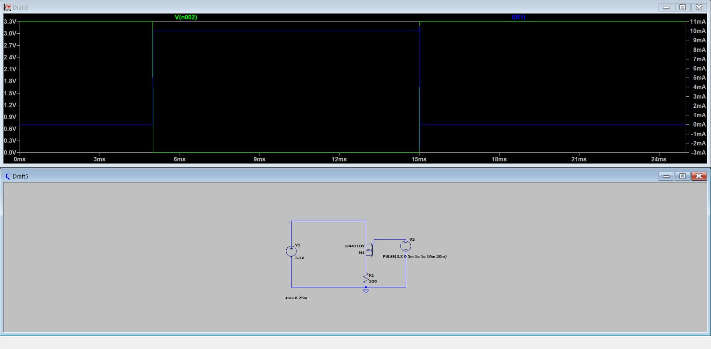

# BOYANT – LTspice Power Management Simulations

LTspice simulations of the BOYANT buoy's power management system, focusing on efficient voltage conversion, battery heating, and sensor power control.

## 1. Synchronous Buck Converters

The system uses synchronous buck converters to step down the 12.8V battery supply to 3.3V and 5V.

Unlike conventional buck converters that use a diode, synchronous converters use a second MOSFET for current conduction. This reduces power losses, minimises heat generation, and improves energy efficiency — particularly important for battery-powered systems operating for extended periods.

**Reported simulation efficiencies:**

| Converter | Efficiency |
|---|---:|
| 12.8V → 3.3V | 98.95% |
| 12.8V → 5V | 92.99% |

*Reported simulation values; hardware efficiency requires experimental validation.*

### 1.1 3.3V Synchronous Buck Converter

Converts the 12.8V battery supply into 3.3V for microcontrollers and low-voltage sensors.

  
   
  <em>3.3V synchronous buck converter circuit schematic</em>

  
   
  <em>Simulated output voltage and startup response</em>

### 1.2 5V Synchronous Buck Converter

Converts the 12.8V battery supply into 5V for peripherals and electronic modules. The switching duty cycle is adjusted to obtain the required output voltage.

  
   
  <em>5V synchronous buck converter circuit schematic</em>

  
   
  <em>Simulated output voltage and startup response</em>

---

## 2. Battery Temperature-Controlled Heater

A MOSFET-based switching stage designed to control a resistive heating element. The N-channel MOSFET acts as a low-side switch, controlling current through the heater.

This provides a foundation for maintaining battery temperature in cold environments.

  
   
  <em>Battery heater MOSFET switching circuit</em>

  
   
  <em>Simulated heater switching behaviour</em>

*Note: The current simulation demonstrates timed switching. Temperature sensing and automatic feedback control are future integration steps.*

---

## 3. Sensor Power Switching

A P-channel MOSFET-based high-side switching circuit designed to control power supplied to sensors.

Sensors can be switched OFF when not required, reducing unnecessary standby power consumption and improving battery utilisation.

  
   
  <em>3.3V sensor power switching schematic</em>

  
   
  <em>Simulated sensor power switching behaviour</em>

---

## 4. Components & Tools

| Component | Specification |
|---|---|
| Simulation software | LTspice |
| Input supply | 12.8V |
| N-channel MOSFET | Si4410DY |
| P-channel MOSFET | Si4431DY |
| Inductor | 22µH |
| Capacitor | 100µF |
| Switching frequency | 200kHz |

## 5. Future Improvements

- Closed-loop voltage regulation and soft-start.
- Overcurrent and overvoltage protection.
- MOSFET gate-driver integration.
- Thermal analysis and optimisation.
- Temperature-feedback-based heater control.
- Hardware implementation and efficiency validation.

---

**Project:** BOYANT – Buoy-based Ocean Yield & Autonomous Navigation Technology  
**Simulation Environment:** LTspice
