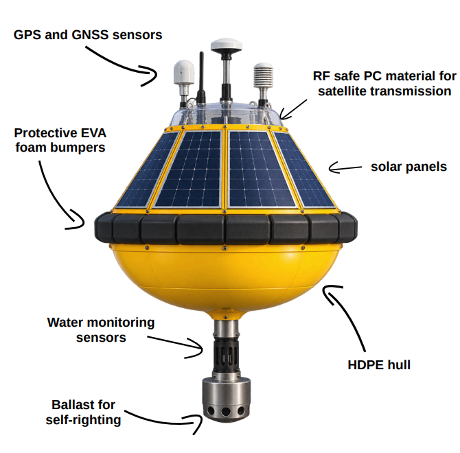
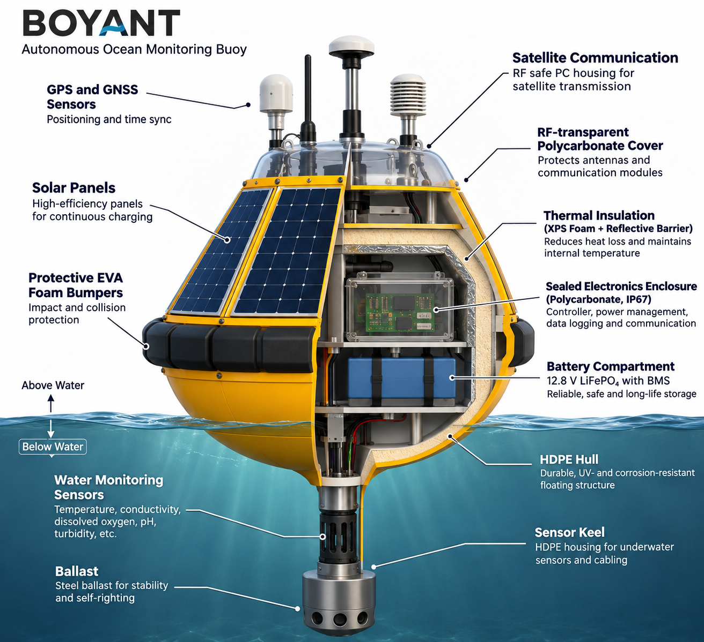
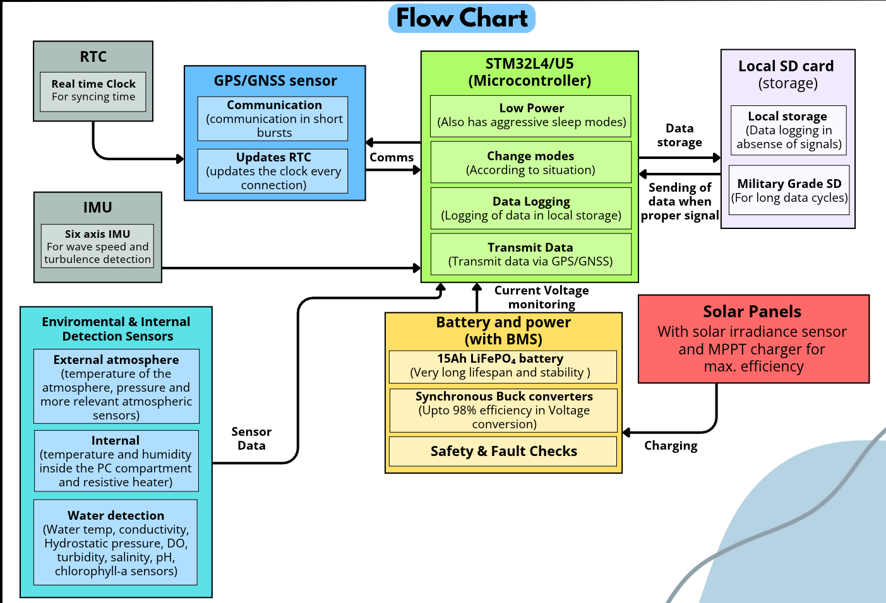

# BOYANT — Polar Autonomous Environmental Monitoring Buoy

<p align="center">
  
</p>

<p align="center">
  An autonomous, solar-powered environmental monitoring platform designed for polar and extreme cold-water environments. (AI visualization)
</p>

---

## 1. Introduction

BOYANT is a concept for an autonomous environmental monitoring buoy designed to operate in **polar regions**, where extremely low temperatures, limited solar availability, harsh weather conditions, and restricted maintenance access make conventional monitoring systems difficult to sustain.

The platform combines a self-righting buoyant hull, thermal insulation, solar energy harvesting, battery storage, and an embedded monitoring system to support long-duration environmental data collection.

The hull is designed around three primary objectives:

- **Stability:** A self-righting structure with a submerged ballast system to maintain its orientation in rough water.
- **Thermal protection:** An insulated internal compartment to protect batteries and electronics against extreme cold.
- **Autonomy:** Solar-powered operation with intelligent power management to reduce dependence on external maintenance.

BOYANT is designed as a modular platform capable of collecting environmental measurements and periodically transmitting stored data.

### Key Design Specifications

| Parameter | Design |
|---|---|
| Application | Polar environmental monitoring |
| Deployment environment | Antarctic / Southern Ocean |
| Power source | Solar energy |
| Battery architecture | 4S LiFePO₄ |
| Power management | MPPT + synchronous buck converters |
| Controller | Embedded microcontroller |
| Data storage | MicroSD |
| Communication | GNSS + satellite communication concept |
| Monitoring duration | 365-day simulated operation |
| Simulation resolution | Hourly |
| Environmental data | NASA POWER |

### Environmental Reference Location

The energy simulation uses historical environmental data from NASA POWER, assuming a representative polar-region deployment location.

| Parameter | Value |
|---|---|
| Latitude | -63.6686° |
| Longitude | 40.4935° |
| Data source | NASA POWER |
| Dataset | Hourly meteorological and solar radiation data |
| Simulation period | 01 January 2025 – 31 December 2025 |
| Total observations | 8,760 hourly records |

The selected coordinates represent the environmental reference point used for the simulation, rather than a confirmed physical deployment location.

### Energy and Operational Performance

The power system is designed around solar energy harvesting, battery storage, and controlled distribution to the electronics and thermal protection system.

The 365-day baseline simulation produced the following results:

| Performance metric | Simulated result |
|---|---:|
| Minimum battery SOC | 78.6% |
| Final battery SOC | 100% |
| Brownout duration | 0 hours |
| Total simulated heater energy | 133 Wh |
| Minimum battery temperature | -9°C |

These results indicate that the modeled energy architecture maintained sufficient battery charge throughout the simulated year under the baseline assumptions.

**Important:** The 365-day simulation demonstrates modeled energy autonomy, not a verified physical service life of 365 days or multiple years. Actual battery longevity, structural durability, and overall system efficiency require hardware testing and validation.

---

## 2. Structural Design and Thermal Engineering

<p align="center">
  
</p>

The mechanical architecture is designed to protect the internal electronics while maintaining buoyancy, stability, and thermal isolation in cold-water environments.

The structure is divided into functional regions rather than treating the buoy as a single enclosure. (AI visualization)

### 2.1 Hull and Buoyancy Structure

The outer hull uses an HDPE-based structural concept.

Its primary functions are:

- Providing buoyancy and protecting internal components.
- Withstanding environmental exposure and mechanical loading.
- Supporting a self-righting geometry.
- Isolating the internal equipment compartment from direct water exposure.

The hull incorporates a submerged ballast arrangement using steel mass to lower the centre of gravity and improve stability.

### 2.2 Internal Equipment Compartment

The central compartment houses the electrical and energy storage systems.

It is designed to accommodate:

- LiFePO₄ battery pack.
- Power management and regulation circuitry.
- Main controller and sensor interfaces.
- Data logging and communication hardware.

A protected polycarbonate enclosure is used as the internal electronics housing concept, providing an additional barrier against moisture and environmental exposure.

### 2.3 Thermal Management

Thermal management is particularly important because low temperatures affect battery performance, electronics reliability, and energy availability.

The thermal architecture incorporates:

**XPS insulation**

Extruded polystyrene insulation surrounds the protected equipment compartment to reduce conductive heat loss.

**Reflective insulation**

Reflective insulation is incorporated into the thermal barrier to reduce radiative heat transfer.

**Controlled heating**

An electrically controlled resistive heating element provides supplemental thermal protection when the internal temperature approaches the configured lower operating threshold.

**Thermal isolation**

The internal equipment compartment is separated from the external hull environment to minimise unwanted heat transfer.

The objective is to maintain a suitable operating temperature without continuously consuming battery energy for heating.

---

## 3. Electronics and Power Architecture

<p align="center">
  
</p>

The electronics architecture follows a centralised power distribution approach.

Solar energy is harvested, regulated, stored in the battery pack, and distributed to different subsystems through dedicated voltage regulation stages.

### 3.1 Power Distribution

The primary power architecture consists of:

1. Solar panel — provides the primary energy input.
2. MPPT charge controller — manages solar energy harvesting and battery charging.
3. 4S LiFePO₄ battery — stores harvested energy.
4. Synchronous buck converters — generate regulated voltage rails.
5. Load switches — independently control selected subsystems.

The regulated power rails supply the controller, sensors, data logging, communication, and other electrical loads.

### 3.2 Synchronous Buck Converters

Dedicated synchronous buck converter designs were developed and simulated using LTspice.

The converters are designed to step down the nominal 12.8 V battery voltage to the required operating voltages.

| Parameter | 3.3 V Converter | 5 V Converter |
|---|---:|---:|
| Input voltage | 12.8 V | 12.8 V |
| Output voltage | 3.3 V | 5 V |
| Switching frequency | 200 kHz | 200 kHz |
| Inductor | 22 µH | 22 µH |
| Output capacitor | 100 µF | 100 µF |
| Load resistance | 5 Ω | 5 Ω |
| Output current | 0.66 A | 1 A |
| Output power | 2.178 W | 5 W |

Both converter designs use Si4410DY MOSFETs in a synchronous switching configuration.

The synchronous topology uses controlled high-side and low-side switching to reduce conduction losses compared with conventional diode-based buck conversion.

**Note:** These are simulated operating points. Converter efficiency must be established through switching-loss analysis and hardware measurements rather than inferred from output voltage and current alone.

### 3.3 Sensor Power Switching

A dedicated electronic load-switching stage is included to control selected sensor subsystems.

The simulated switching circuit uses:

- Si4431DY MOSFET.
- 330 Ω gate resistor.
- 3.3 V control signal.
- 10 mA switched load current.
- 33 mW load power.

This allows the controller to disable selected loads when measurements are not required, reducing unnecessary energy consumption.

### 3.4 Thermal Protection Circuit

The heating subsystem uses a resistive heating element controlled through an electronic switching stage.

| Parameter | Value |
|---|---:|
| Heater resistance | 10 Ω |
| Supply voltage | 12.8 V |
| Heater power when ON | 16.384 W |
| Duty cycle | 50% |
| Average heater power | 8.192 W |

The heater is intended to operate intermittently according to temperature conditions rather than remain continuously powered.

### 3.5 Embedded Monitoring and Data Handling

The embedded architecture coordinates sensor acquisition, power management, data logging, and communication.

The intended monitoring parameters include:

**Water measurements**
- Water temperature
- Conductivity
- Pressure / depth
- Dissolved oxygen
- Turbidity
- pH

**Atmospheric measurements**
- Air temperature
- Relative humidity
- Atmospheric pressure
- Solar irradiance

The system is designed around periodic sensing, local data storage, and scheduled communication to minimise power consumption.

---

## 4. Simulation and Engineering Validation

BOYANT incorporates multiple engineering simulations to evaluate the feasibility of its structural, electrical, thermal, and energy systems.

The project includes:

- Mechanical and buoyancy design.
- Stability and ballast considerations.
- Thermal insulation and heater energy modelling.
- Electrical power distribution.
- LTspice synchronous buck converter simulations.
- Electronic load-switching simulations.
- 365-day solar energy and battery SOC simulation.
- Baseline and environmental stress scenarios.
- Monte Carlo analysis for energy-system variability.

### 4.1 NASA POWER Environmental Simulation

A complete 365-day energy simulation was performed using hourly environmental data retrieved from **NASA POWER (Prediction Of Worldwide Energy Resources)**.

The dataset contains:

- `ALLSKY_SFC_SW_DWN` — All-sky surface shortwave downward irradiance.
- `T2M` — Temperature at 2 metres.
- `RH2M` — Relative humidity at 2 metres.
- `WS10M` — Wind speed at 10 metres.

The environmental data was used as input to the energy model to evaluate solar energy availability, battery state of charge, temperature conditions, and heater energy consumption.

The simulation covered 8,760 hourly observations from January to December 2025.

### 4.2 Energy-System Evaluation

The energy model evaluates the relationship between harvested solar energy, battery storage, electrical loads, and thermal protection.

The baseline scenario maintained a minimum battery SOC of 78.6%, finished the simulation at 100% SOC, and recorded zero brownout hours.

Additional stress scenarios and Monte Carlo runs were used to examine the system under varying operating assumptions.

### 4.3 Electrical Simulation

LTspice was used to evaluate the synchronous buck converter designs, switching behaviour, output voltage regulation, and electronic load-switching circuits.

These simulations provide an initial electrical design validation before physical PCB fabrication and hardware testing.

### Detailed Simulation Documentation

For the complete simulation methodology, input datasets, assumptions, configuration parameters, stress scenarios, Monte Carlo analysis, results, and visualisations, refer to:

**[`Iteration2/README.md`](Iteration2/README.md)**

---

## 5. Project Status and Future Development

BOYANT is currently an engineering design and simulation project.

The present work focuses on establishing the mechanical architecture, thermal protection strategy, electrical power distribution, and long-duration energy feasibility.

Future development includes:

- Physical hull fabrication and buoyancy testing.
- Thermal chamber testing under low-temperature conditions.
- Solar charging and battery endurance testing.
- PCB fabrication and electrical validation.
- Sensor integration and calibration.
- Communication-system integration.
- Long-duration field deployment and environmental validation.

The ultimate objective is to develop a reliable, autonomous environmental monitoring platform capable of operating in remote polar environments with minimal maintenance.

---

## 6. Repository Structure

```text
BOYANT/
│
├── Iteration2/
│   ├── assets/
│   ├── simulations/
│   │   └── README.md
│   ├── LTSpice_sim/
│   ├── buoyant_report/
│   └── ...
│
├── Media/
│   ├── boyant_main.png
│   ├── boyant_section_view.png
│   └── boyant_electronics_flowchart.png
│
└── README.md
```

*Repository structure is illustrative; update paths to match the actual files.*

---

<p align="center">
  **BOYANT — Engineering autonomous environmental monitoring for the extremes.**
</p>
